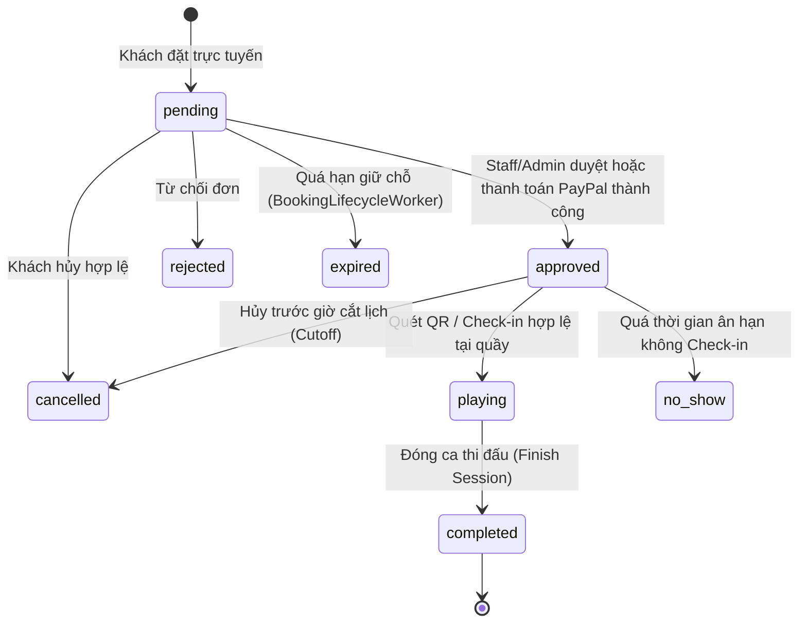

# ⚡ SPIKE PICKLEBALL CLUB — HỆ THỐNG QUẢN LÝ, ĐẶT SÂN, THU NGÂN & SÂN GIAO LƯU

> **Nền tảng vận hành cụm sân thể thao & kết nối cộng đồng hội viên Pickleball**  
> Xây dựng trên **ASP.NET Core 10.0 MVC**, **Entity Framework Core 10.0** và **Microsoft SQL Server**.


---

## 📖 Mục Lục
- [1. Tổng Quan Hệ Thống](#1-tổng-quan-hệ-thống)
- [2. Kiến Trúc Kỹ Thuật & Bảo Mật](#2-kiến-trúc-kỹ-thuật--bảo-mật)
- [3. Chức Năng Nghiệp Vụ Chính](#3-chức-năng-nghiệp-vụ-chính)
- [4. Vòng Đời Đặt Sân & Sổ Cái Thu Ngân](#4-vòng-đời-đặt-sân--sổ-cái-thu-ngân)
- [5. Cấu Trúc Thư Mục Dự Án](#5-cấu-trúc-thư-mục-dự-án)
- [6. Hướng Dẫn Cài Đặt, Migration & Kiểm Thử](#6-hướng-dẫn-cài-đặt-migration--kiểm-thử)
- [7. Kho Tài Liệu Kỹ Thuật & Vận Hành (`docs/`)](#7-kho-tài-liệu-kỹ-thuật--vận-hành-docs)

---

## 1. Tổng Quan Hệ Thống

**Spike Pickleball Club** là ứng dụng web quản lý trọn vẹn hoạt động của cụm sân Pickleball trong nhà (Indoor Cushion 8 lớp) và ngoài trời (Outdoor), kết hợp quản trị vận hành chuẩn xác với không gian tương tác cộng đồng hội viên:

- **Chống đặt trùng lịch tuyệt đối ở mức SQL Server**: Khóa hàng `UPDLOCK, HOLDLOCK` trong giao dịch `Serializable` cho cả tạo đơn mới, giữ chỗ có thời hạn (`Hold TTL`), gia hạn ca (`+30p`), đổi sân và khóa sân bảo trì.
- **Định giá bậc thang tách đoạn theo phút**: Tự động tách chính xác thời lượng rơi vào giờ thường và khung giờ vàng (`Peak-hour`) theo cấu hình động từ CMS, đồng bộ phiên bản báo giá (`PricingVersion`).
- **Mã vé QR chuẩn quốc tế ISO/IEC 18004**: Sinh ảnh QR thương hiệu (`SVG` & `PNG`) bằng `QRCoder` chứa chữ ký số `HMAC-SHA256` (`SPK1...`, không lộ PII) và giải mã độc lập phía máy chủ bằng `ZXing.Net` + `SixLabors.ImageSharp`.
- **Sổ cái thu ngân bất biến & Thanh toán PayPal quốc tế**: Tách bạch đóng ca thi đấu (`completed`) với xác nhận thu tiền mặt/chuyển khoản/`PayPal Sandbox` và hoàn tiền đối ứng (`refund`); trừ/hoàn tồn kho Pro Shop nguyên tử kèm lịch sử `tb_InventoryMovement`.
- **Trợ lý ảo Spike AI Mascot (Google Gemini)**: Tư vấn khung giờ sân trống, báo giá dự kiến và gợi ý dụng cụ Pro Shop theo dữ liệu thời gian thực của CLB.
- **Sân giao lưu 2D Pixel (`/SanGiaoLuu`)**: Mặt sân tương tác trực quan với 8 nhân vật pixel sống động đồng bộ từ hồ sơ hội viên (`/Account/Profile`), tự động di chuyển, biểu cảm nháy mắt/chớp mắt, tìm bạn tập theo trình độ DUPR và gửi lời mời giao lưu.

---

## 2. Kiến Trúc Kỹ Thuật & Bảo Mật

### Backend & Cơ Sở Dữ Liệu
- **Framework**: `ASP.NET Core 10.0 MVC` + REST JSON APIs + Background Hosted Workers (`BookingLifecycleWorker`, `PayPalReconciliationWorker`).
- **ORM & Schema**: `Entity Framework Core 10.0` với chuỗi Versioned Migrations (`V2` -> `V4` -> `V5` -> `V6`), cột tiền tệ `DECIMAL(18,2)`, khóa `ROWVERSION` chống ghi đè mù và cơ chế `Idempotency` chống gửi lặp giao dịch.
- **Xác thực & Phân quyền (RBAC)**:
  - Mật khẩu băm chuẩn `PBKDF2` (`PasswordHasher<TbAccount>`), tự động nâng cấp minh bạch từ mã băm cũ khi đăng nhập.
  - Cookie xác thực ký số (`HttpOnly`, `SameSite=Lax`, `SecurePolicy=Always` ở Production) kèm kiểm tra `SecurityStamp` theo từng request để thu hồi phiên ngay lập tức khi khóa tài khoản hoặc đổi quyền.
  - Phân tách chặt chẽ 3 vai trò: `Admin (RoleId = 1)`, `Customer (RoleId = 2)` và `Staff (RoleId = 3)`.
- **Bảo vệ API & Chống IDOR / CSRF / XSS**:
  - Bắt buộc `ValidateAntiForgeryToken` trên toàn bộ biểu mẫu và JSON API thay đổi dữ liệu.
  - Snapshot công khai `GET /api/db/state` và API Sân giao lưu `/api/social/*` lọc bỏ hoàn toàn dữ liệu nhạy cảm (`Email`, `Phone`, `PasswordHash`).
  - Tra cứu/hủy vé khách vãng lai yêu cầu đồng thời `BookingCode` + mã bảo mật vé bí mật một lần (`bk_...` băm `SHA-256`).

### Frontend
- **Kiến trúc CSS mô-đun**: Phân tách rõ `core/` (reset, tokens), `components/` (primitives, vé QR, AI mascot), `layouts/` (public shell, admin shell) và `pages/` theo từng phân hệ.
- **Hoạt ảnh 2D Canvas & Sprite Atlas**: Bộ dựng cảnh `san-giao-luu-engine.js` điều khiển lưới sprite `8×4` (`96×104 px`) với chu kỳ bước chân theo quãng đường thực, biểu cảm mắt độc lập và 32 động tác cá tính riêng.

---

## 3. Chức Năng Nghiệp Vụ Chính

### Phân Hệ Khách Hàng & Hội Viên (`Customer`)
- **Trang chủ (`/`)**: Xem tình trạng sân trống trực quan, bảng giá giờ thường/giờ vàng từ CMS và lối tắt đặt sân nhanh.
- **Đặt sân trực tuyến (`/Booking`) & Thanh toán PayPal (`/Payment`)**: Chọn sân, khung giờ, nhận báo giá tách đoạn từ `GET /api/bookings/quote`, thanh toán trực tuyến qua PayPal hoặc tại quầy, nhận vé QR thương hiệu.
- **Cửa hàng Pro Shop (`/Product`)**: Lọc danh mục vợt, bóng, phụ kiện & giải khát; đặt mua lẻ hoặc gộp vào ca sân đang hoạt động.
- **Sân giao lưu Pixel (`/SanGiaoLuu`)**: Xem hội viên đang hiện diện trên sân dưới dạng nhân vật pixel, mở Thẻ hồ sơ VĐV, lọc người đang sẵn sàng giao lưu, ghép cặp bạn tập phù hợp và gửi/nhận lời mời đánh cùng.
- **Tra cứu & Hủy vé (`/Lookup`)**: Hội viên xem lịch sử đặt sân của tài khoản; khách lẻ tra cứu và hủy vé hợp lệ bằng `Mã đặt sân + Mã bảo mật vé`.
- **Hồ sơ VĐV (`/Account/Profile`)**: Chọn 1 trong 8 nhân vật đại diện hoặc tải ảnh cá nhân (đồng bộ trực tiếp sang `/SanGiaoLuu`), cập nhật trình độ DUPR, lối đánh và xem hạng thẻ hội viên.

### Phân Hệ Điều Hành (`Staff`) & Quản Trị (`Admin`)
- **Điều phối Sân, POS & Sổ cái (`/Management`)**: Duyệt/từ chối đơn chờ, đặt lịch khách lẻ tại quầy, gia hạn `+30p`, chuyển sân, bán hàng POS trừ kho nguyên tử, đóng ca thi đấu và ghi nhận thu/hoàn tiền trên sổ cái.
- **Trạm Soát vé QR (`/Checkin`)**: Quét Camera trực tiếp, tải tệp ảnh QR (`.PNG/.JPG/.WEBP`) giải mã bằng `ZXing.Net` trên server hoặc nhập token ký số.
- **Báo cáo Sổ cái Tài chính (`/Reports`)**: Thống kê thực thu ròng (`Payments - Refunds`), doanh thu sân vs Pro Shop, công nợ chưa thu và chi tiêu hội viên.
- **Quản trị Hệ thống (`Admin` độc quyền)**: Quản lý sân (`/Admin/Courts`), sản phẩm POS (`/Admin/Products`), lịch đặt (`/Admin/Bookings`), tài khoản & nhân sự (`/Admin/Accounts`), menu (`/Admin/Menus`) và cấu hình CMS (`/Cms`).

---

## 4. Vòng Đời Đặt Sân & Sổ Cái Thu Ngân



> **Nguyên tắc sổ cái**: Chuyển trạng thái sang `completed` chỉ giải phóng vận hành sân, **không tự động đánh dấu đã thu tiền**. Trạng thái thanh toán (`unpaid` / `partial` / `paid` / `refunded`) được tính toán trực tiếp từ tổng bút toán trong bảng `tb_PaymentTransaction`.

---

## 5. Cấu Trúc Thư Mục Dự Án

```text
pickleball/
├── Areas/Admin/                # Phân hệ Quản trị (Courts, Products, Bookings, Accounts, Menus)
├── Configuration/              # Cấu hình mạnh kiểu (GeminiOptions, PayPalOptions)
├── Controllers/                # MVC Controllers & REST APIs (Booking, Payment, Assistant, SanGiaoLuu, ApiDb)
├── Logging/                    # CleanSpikeConsoleFormatter & CorrelationContext theo dõi RequestId
├── Migrations/                 # EF Core Versioned Migrations (V2 -> V4 -> V5 PayPal -> V6 Sân giao lưu)
├── Models/                     # Thực thể EF Core (Tb*) & PickleballContext
├── Services/                   # Tầng nghiệp vụ cốt lõi (Booking, Pricing, Order, QR, PayPal, Gemini, SocialCourt)
├── Utilities/                  # Cookie Claims, SecurityStamp, CSRF & Session Helpers
├── ViewComponents/             # Thành phần Razor tái sử dụng (MenuTop, Court, Product)
├── Views/                      # Giao diện Razor phía khách hàng, hội viên & trạm vận hành
├── wwwroot/                    # Tài nguyên tĩnh (CSS phân tầng, JS modules, ảnh sân/sản phẩm & sprite pixel)
├── prototypes/san-giao-luu/    # Bản mẫu HTML tĩnh đối chiếu thiết kế nhân vật pixel
├── scripts/demo-only/          # Script SQL tạo dữ liệu mẫu cho môi trường lab trống
├── PickleballClub.Tests/       # Bộ kiểm thử tự động xUnit (Concurrency, QR, Security, PayPal, AI, Sân giao lưu)
└── docs/                       # Kho tài liệu kiến trúc, hướng dẫn cấu hình & hồ sơ nghiệm thu theo phân hệ
```

---

## 6. Hướng Dẫn Cài Đặt, Migration & Kiểm Thử

### Yêu Cầu Môi Trường
- **.NET SDK 10.0** (`10.0.100+`).
- **Microsoft SQL Server** (`2019/2022` hoặc `.\SQLEXPRESS`).

### Bước 1: Cấu Hình Kết Nối & Khóa Bảo Mật
Kiểm tra `ConnectionStrings:DefaultConnection` trong `appsettings.json` hoặc đặt qua biến môi trường / `dotnet user-secrets`:
```powershell
$env:ConnectionStrings__DefaultConnection = "Server=.\SQLEXPRESS;Database=PickleballClub;Trusted_Connection=True;TrustServerCertificate=True;MultipleActiveResultSets=true"
$env:SPIKE_QR_SIGNING_KEY = "<chuoi-bi-mat-ngau-nhien-toi-thieu-32-ky-tu>"
```
*(Tùy chọn: Xem thêm cấu hình PayPal Sandbox tại [`docs/paypal/PAYPAL_CONFIGURATION_GUIDE.md`](docs/paypal/PAYPAL_CONFIGURATION_GUIDE.md) và Gemini AI tại [`docs/ai-assistant/SPIKE_AI_CONFIGURATION.md`](docs/ai-assistant/SPIKE_AI_CONFIGURATION.md)).*

### Bước 2: Chạy EF Core Migrations & Khởi Động Ứng Dụng
```powershell
dotnet restore
dotnet run --project PickleballClub.csproj -- --migrate
dotnet run --project PickleballClub.csproj
```
Kiểm tra trạng thái dịch vụ tại `/health`.

### Bước 3: Chạy Bộ Kiểm Thử Tự Động
```powershell
dotnet test PickleballClub.Tests/PickleballClub.Tests.csproj -c Release
```

---

## 7. Kho Tài Liệu Kỹ Thuật & Vận Hành (`docs/`)

Toàn bộ tài liệu hiện hành được tổng hợp gọn tại [`docs/README.md`](docs/README.md):

- **Kiến trúc & Bản đồ Mã nguồn**: [`docs/ARCHITECTURE_AND_MODULES.md`](docs/ARCHITECTURE_AND_MODULES.md)
- **Triển khai, Sao lưu & Rollback**: [`docs/DEPLOY_AND_ROLLBACK.md`](docs/DEPLOY_AND_ROLLBACK.md)
- **Sân giao lưu & Sprite Pixel (V6)**: [`docs/san-giao-luu/SPRITE_AND_ANIMATION_GUIDE.md`](docs/san-giao-luu/SPRITE_AND_ANIMATION_GUIDE.md)
- **Trợ lý ảo Spike AI Mascot**: [`docs/ai-assistant/SPIKE_AI_CONFIGURATION.md`](docs/ai-assistant/SPIKE_AI_CONFIGURATION.md) · [`docs/ai-assistant/SPIKE_AI_ARCHITECTURE.md`](docs/ai-assistant/SPIKE_AI_ARCHITECTURE.md)
- **Cổng thanh toán PayPal (V5)**: [`docs/paypal/PAYPAL_CONFIGURATION_GUIDE.md`](docs/paypal/PAYPAL_CONFIGURATION_GUIDE.md) · [`docs/paypal/PAYPAL_RECONCILIATION.md`](docs/paypal/PAYPAL_RECONCILIATION.md)
- **Hệ thống Thiết kế & Nhật ký**: [`docs/design-system/DESIGN_SYSTEM.md`](docs/design-system/DESIGN_SYSTEM.md) · [`docs/logging/LOGGING_CONFIGURATION.md`](docs/logging/LOGGING_CONFIGURATION.md)
