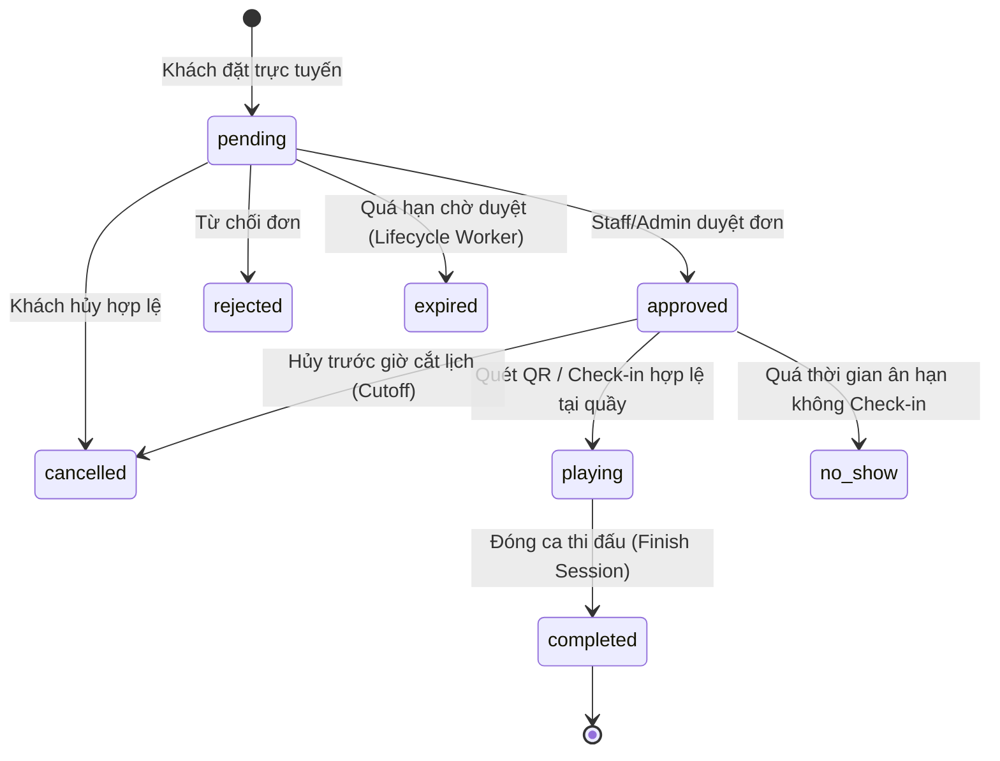

# ⚡ SPIKE PICKLEBALL CLUB — HỆ THỐNG QUẢN LÝ, ĐẶT SÂN & SỔ CÁI THU NGÂN

> **Ứng dụng quản lý vận hành cụm sân thể thao Pickleball**  
> Xây dựng trên nền tảng **ASP.NET Core 10.0 MVC**, **Entity Framework Core 10.0** và **Microsoft SQL Server**.


---

## 📖 Mục Lục
- [1. Tổng Quan Hệ Thống](#1-tổng-quan-hệ-thống)
- [2. Kiến Trúc Kỹ Thuật & Bảo Mật (V2)](#2-kiến-trúc-kỹ-thuật--bảo-mật-v2)
- [3. Chức Năng Nghiệp Vụ Chính](#3-chức-năng-nghiệp-vụ-chính)
- [4. Vòng Đời Đặt Sân & Sổ Cái Thu Ngân](#4-vòng-đời-đặt-sân--sổ-cái-thu-ngân)
- [5. Cấu Trúc Thư Mục Dự Án](#5-cấu-trúc-thư-mục-dự-án)
- [6. Hướng Dẫn Cài Đặt, Migration & Kiểm Thử](#6-hướng-dẫn-cài-đặt-migration--kiểm-thử)
- [7. Tài Liệu Vận Hành & Nghiệm Thu](#7-tài-liệu-vận-hành--nghiệm-thu)

---

## 1. Tổng Quan Hệ Thống

**Spike Pickleball Club** là hệ thống web phục vụ vận hành cụm sân Pickleball trong nhà (Indoor Cushion 8 lớp) và ngoài trời (Outdoor), tập trung vào tính toàn vẹn dữ liệu SQL Server, kiểm soát đồng thời (Concurrency), sổ cái thu ngân bất biến (Immutable Payment Ledger) và trải nghiệm người dùng trên đa thiết bị:

- **Chống đặt trùng lịch tuyệt đối ở mức cơ sở dữ liệu**: Khóa hàng `UPDLOCK, HOLDLOCK` trong giao dịch `Serializable` cho cả tạo đơn mới, gia hạn ca (`+30p`), đổi sân và khóa sân bảo trì.
- **Định giá bậc thang tách đoạn theo phút**: Tự động tách chính xác thời lượng rơi vào giờ thường và khung giờ vàng (`Peak-hour`) theo cấu hình động từ CMS, đồng bộ phiên bản báo giá (`PricingVersion`).
- **Mã vé QR chuẩn quốc tế ISO/IEC 18004**: Sinh ảnh QR thật (`SVG` & `PNG`) bằng `QRCoder` chứa token ký số `HMAC-SHA256` (`SPK1...`, không chứa PII) và giải mã độc lập phía máy chủ bằng `ZXing.Net` + `SixLabors.ImageSharp`.
- **Sổ cái thu ngân & tồn kho Pro Shop nguyên tử**: Tách bạch thao tác đóng ca thi đấu (`completed`) với xác nhận thu tiền (`cash`/`transfer` kèm `ReferenceCode`) và bút toán hoàn tiền đối ứng (`refund`); trừ/hoàn tồn kho nguyên tử kèm lịch sử biến động (`tb_InventoryMovement`).

---

## 2. Kiến Trúc Kỹ Thuật & Bảo Mật (V2)

### Backend & Cơ Sở Dữ Liệu
- **Framework**: `ASP.NET Core 10.0 MVC` + REST JSON APIs.
- **ORM & Schema**: `Entity Framework Core 10.0` với Versioned Migrations (`--migrate`), cột tiền tệ kiểu `DECIMAL(18,2)`, `ROWVERSION` chống ghi đè mù và trigger SQL bảo vệ tính bất biến của bảng `tb_PaymentTransaction`.
- **Xác thực & Phân quyền (RBAC)**:
  - Mật khẩu băm chuẩn `PBKDF2` (`PasswordHasher<TbAccount>`), tự động nâng cấp minh bạch từ mã băm cũ khi đăng nhập.
  - Cookie xác thực ký số (`HttpOnly`, `SameSite=Lax`, `SecurePolicy=Always` ở Production) kèm kiểm tra `SecurityStamp` theo từng request (`OnValidatePrincipal`) để thu hồi phiên ngay lập tức khi khóa tài khoản hoặc đổi quyền.
  - Phân tách rõ 3 vai trò: `Admin (RoleId = 1)`, `Customer (RoleId = 2)` và `Staff (RoleId = 3)`.
- **Bảo vệ API & Chống IDOR / CSRF / XSS**:
  - Bắt buộc `ValidateAntiForgeryToken` (`RequestVerificationToken`) trên toàn bộ biểu mẫu và JSON API thay đổi dữ liệu.
  - Snapshot công khai `GET /api/db/state` chỉ đọc, hỗ trợ `ETag` / `304 Not Modified`, ẩn hoàn toàn thông tin cá nhân (chỉ xuất khoảng bận ẩn danh `occupied`).
  - Tra cứu/hủy vé khách vãng lai yêu cầu đồng thời `BookingCode` + mã bảo mật vé bí mật một lần (`bk_...` băm `SHA-256`), không bao giờ xác thực quyền sở hữu chỉ bằng số điện thoại tự khai.

### Frontend
- **Thiết kế giao diện**: Phong cách thể thao hiện đại (`Oswald` + `Plus Jakarta Sans`), kiểm thử tự động không tràn ngang ở 4 mốc `375px`, `768px`, `1024px` và `1440px`.
- **Biểu tượng**: `Iconify` được lọc qua whitelist server-side (`IconSanitizer`) chống Stored XSS.

---

## 3. Chức Năng Nghiệp Vụ Chính

### Phân Hệ Khách Hàng & Hội Viên
- **Trang chủ (`/`)**: Xem tình trạng sân trống theo thời gian thực (ẩn danh PII), bảng giá giờ thường/giờ vàng từ CMS và thanh chuyển nhanh sang trang đặt sân.
- **Đặt sân trực tuyến (`/Booking`)**: Chọn ngày, sân, thời lượng, khung giờ trống; báo giá tách đoạn trực tiếp từ `GET /api/bookings/quote`; nhận mã vé QR (`SVG`/`PNG`) và mã bảo mật tra cứu vé (`bk_...`).
- **Cửa hàng Pro Shop (`/Product`)**: Tìm kiếm, lọc danh mục, đặt mua lẻ tại quầy hoặc gộp vào ca sân đang hoạt động trong ngày (có xác minh chủ sở hữu ca sân).
- **Tra cứu & Hủy vé (`/Lookup`)**: Hội viên đăng nhập xem toàn bộ lịch của tài khoản (`GET /api/bookings/me`); khách lẻ tra cứu và tự hủy vé hợp lệ bằng `Mã đặt sân + Mã bảo mật vé`.
- **Hồ sơ VĐV (`/Account/Profile`)**: Quản lý thông tin VĐV (trình độ DUPR, tay thuận, lối đánh), đổi mật khẩu an toàn và xem hạng thẻ hội viên tính từ chi tiêu thực thu đã xác thực trên sổ cái.

### Phân Hệ Điều Hành (`Staff`) & Quản Trị (`Admin`)
- **Điều phối Sân, POS & Sổ cái (`/Management`)**: Duyệt/từ chối đơn chờ, đặt lịch khách vãng lai tại quầy, gia hạn `+30p`, chuyển sân, gọi món POS trừ kho nguyên tử, đóng ca thi đấu, ghi nhận thu tiền một phần/toàn phần, hoàn tiền đối ứng và tất toán đơn lẻ Pro Shop.
- **Trạm Soát vé QR (`/Checkin`)**: Hỗ trợ 3 chế độ thực tế: Quét Camera trực tiếp, Tải tệp ảnh mã QR (`.PNG/.JPG/.WEBP`) giải mã bằng `ZXing.Net` trên server, hoặc nhập mã token ký số. Chặn check-in đối với vé chưa duyệt (`pending`) hoặc ngoài khung giờ cho phép.
- **Báo cáo Sổ cái Tài chính (`/Reports`)**: Thống kê thực thu ròng (`Payments - Refunds`), doanh thu sân vs đơn lẻ Pro Shop, công nợ chưa thu (`Receivables`) và chi tiêu hội viên lọc chính xác theo thời điểm giao dịch thực tế (`CreatedAt`).
- **Quản trị Hệ thống (`Admin` độc quyền)**: Quản lý sân (`/Admin/Courts`), sản phẩm POS (`/Admin/Products`), tài khoản & nhân sự (`/Admin/Accounts` — cấp mật khẩu tạm ngẫu nhiên bắt đổi lần đầu), thanh điều hướng (`/Admin/Menus`) và cấu hình CMS (`/Cms`).

---

## 4. Vòng Đời Đặt Sân & Sổ Cái Thu Ngân



> **Nguyên tắc sổ cái**: Chuyển trạng thái sang `completed` chỉ giải phóng vận hành sân, **không tự động đánh dấu đã thu tiền**. Trạng thái thanh toán (`unpaid` / `partial` / `paid` / `refunded`) được dẫn xuất hoàn toàn từ tổng bút toán thực tế trong bảng `tb_PaymentTransaction`.

---

## 5. Cấu Trúc Thư Mục Dự Án

```text
pickleball-ui/
├── Areas/Admin/                # Phân hệ Quản trị & Vận hành (Controllers + Views)
├── Controllers/                # MVC Controllers & ApiDbController (REST APIs)
├── Migrations/                 # EF Core Versioned Migrations (V2 Safe Expand & Ledger)
├── Models/                     # EF Core Entities & PickleballContext
├── Services/                   # Domain Services (Booking, Order, Pricing, QrToken, ClubSettings, IconSanitizer)
├── Utilities/                  # Cookie Auth Claims, SecurityStamp & Anti-CSRF Helpers
├── Views/                      # Giao diện Razor phía khách hàng & hội viên
├── wwwroot/                    # Tài nguyên tĩnh (CSS responsive & Vanilla JS modules)
├── PickleballClub.Tests/       # Bộ kiểm thử tự động (Unit, ZXing QR, SQL Concurrency, HTTP Security)
├── scripts/demo-only/          # Script dựng dữ liệu mẫu chỉ dành cho môi trường lab rỗng
└── docs/                       # Tài liệu kiến trúc, vận hành, sao lưu & bằng chứng kiểm thử V2
```

---

## 6. Hướng Dẫn Cài Đặt, Migration & Kiểm Thử

### Yêu Cầu Môi Trường
- **.NET SDK 10.0** (`10.0.100+`).
- **Microsoft SQL Server** (`2019/2022` hoặc `.\SQLEXPRESS`).

### Bước 1: Cấu Hình Chuỗi Kết Nối & Khóa Ký Số
Kiểm tra `ConnectionStrings:DefaultConnection` trong `appsettings.json` (môi trường phát triển cục bộ) hoặc thiết lập qua biến môi trường:
```powershell
$env:ConnectionStrings__DefaultConnection = "Server=.\SQLEXPRESS;Database=PickleballClub;Trusted_Connection=True;TrustServerCertificate=True;MultipleActiveResultSets=true"
$env:SPIKE_QR_SIGNING_KEY = "<chuoi-bi-mat-ngau-nhien-toi-thieu-32-ky-tu>"
```
*(Ở môi trường `Development`, hệ thống cho phép tự nâng cấp schema an toàn khi khởi động; ở `Staging`/`Production`, bắt buộc cấu hình `SPIKE_QR_SIGNING_KEY >= 32 ký tự` và chạy bước `--migrate` tường minh).*

### Bước 2: Áp Dụng EF Core Migrations & Khởi Chạy
```powershell
dotnet restore
dotnet run --project PickleballClub.csproj -- --migrate
dotnet run --project PickleballClub.csproj
```
Kiểm tra trạng thái dịch vụ tại `/health`. Quản trị viên tạo tài khoản vận hành hoặc cấp mật khẩu tạm thời một lần trực tiếp trong `/Admin/Accounts` (không công khai mật khẩu tĩnh trong tài liệu mã nguồn).

### Bước 3: Chạy Bộ Kiểm Thử Tự Động (Unit + SQL Concurrency + HTTP Security)
```powershell
dotnet test PickleballClub.Tests/PickleballClub.Tests.csproj -c Release
```

---

## 7. Tài Liệu Vận Hành & Nghiệm Thu

- [`docs/DEPLOY_AND_ROLLBACK.md`](docs/DEPLOY_AND_ROLLBACK.md): Quy trình sao lưu SQL Server, chạy `--migrate`, kiểm tra `/health`, diễn tập khôi phục và kế hoạch Rollback.
- [`docs/DECISIONS_NEEDED.md`](docs/DECISIONS_NEEDED.md): Danh mục cấu hình bên thứ ba đang chờ thông tin nhà cung cấp thực tế (`P1-02` SMS/SMTP OTP, cổng thanh toán online tùy chọn).
- [`docs/REMEDIATION_MATRIX.md`](docs/REMEDIATION_MATRIX.md): Ma trận đối chiếu toàn bộ 40 hạng mục `P0/P1/P2` theo đúng mã gốc.
- [`docs/TEST_EVIDENCE.md`](docs/TEST_EVIDENCE.md): Bằng chứng thực thi kiểm thử song song SQL Server, giải mã QR `ZXing.Net`, diễn tập Backup/Restore và kiểm tra giao diện đa màn hình.
