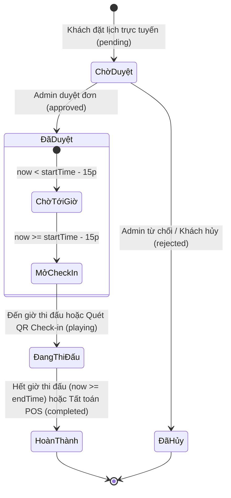

# ⚡ SPIKE PICKLEBALL CLUB — HỆ THỐNG QUẢN LÝ & ĐẶT SÂN PICKLEBALL TRỰC TUYẾN

> **Đồ án học phần Phát triển ứng dụng Web**  
> Xây dựng trên nền tảng **ASP.NET Core 10.0 MVC**, **Entity Framework Core** và **Microsoft SQL Server**.


---

## 📖 Mục Lục
- [1. Giới Thiệu Dự Án](#1-giới-thiệu-dự-án)
- [2. Kiến Trúc & Công Nghệ](#2-kiến-trúc--công-nghệ)
- [3. Tính Năng Chi Tiết](#3-tính-năng-chi-tiết)
  - [3.1 Phân Hệ Khách Hàng / Vận Động Viên](#31-phân-hệ-khách-hàng--vận-động-viên)
  - [3.2 Phân Hệ Quản Trị & Vận Hành CLB (Admin)](#32-phân-hệ-quản-trị--vận-hành-clb-admin)
- [4. Cơ Chế Điều Phối Thời Gian Thực (Real-Time Lifecycle)](#4-cơ-chế-điều-phối-thời-gian-thực-real-time-lifecycle)
- [5. Sơ Đồ Cơ Sở Dữ Liệu (Database Schema)](#5-sơ-đồ-cơ-sở-dữ-liệu-database-schema)
- [6. Cấu Trúc Thư Mục Dự Án](#6-cấu-trúc-thư-mục-dự-án)
- [7. Hướng Dẫn Cài Đặt & Khởi Chạy](#7-hướng-dẫn-cài-đặt--khởi-chạy)
- [8. Tài Khoản Thử Nghiệm](#8-tài-khoản-thử-nghiệm)
- [9. Thông Tin Tác Giả](#9-thông-tin-tác-giả)

---

## 1. Giới Thiệu Dự Án

**Spike Pickleball Club** là nền tảng web ứng dụng hoàn chỉnh phục vụ chuyển đổi số quy trình vận hành cho tổ hợp sân thể thao Pickleball tiêu chuẩn quốc tế **USAPA**. Hệ thống giải quyết triệt để các bài toán thực tế của cụm sân thể thao:

- ❌ **Loại bỏ trùng lịch (Overbooking)** bằng thuật toán kiểm tra xung đột thời gian thực trên trục Timeline 06:00 – 22:00.
- ⚡ **Tự động hóa giá vé thông minh (Dynamic Pricing)**: Phụ thu sân VIP trong nhà mái vòm, tính phụ thu giờ vàng (Peak-hour: 17:00 – 21:00) và công cụ tự động chia tiền nhóm theo đầu người (Split-Bill).
- 📱 **Trải nghiệm di động liền mạch**: Giao diện chuẩn mực responsive trên Mobile, Tablet, Laptop và Desktop lớn, không tràn ngang, tốc độ tải trang tức thì.
- 🥤 **Bán lẻ Pro Shop & Thu ngân POS trực quan**: Khách có thể đặt nước giải khát, đồ ăn nhẹ, thuê vợt thi đấu Carbon T700 giao tận sân hoặc gộp trực tiếp vào hóa đơn vé sân đang chơi.
- 🛡️ **Trung tâm quản trị toàn diện**: Phê duyệt đặt sân 1-chạm, trạm quét mã QR soát vé, quản lý khóa sân bảo trì định kỳ, báo cáo doanh thu và hồ sơ hội viên VĐV.

---

## 2. Kiến Trúc & Công Nghệ

### Backend
- **Framework**: `ASP.NET Core 10.0 MVC` (C# 13 / .NET 10).
- **ORM & Data Access**: `Entity Framework Core 10.0` (Hỗ trợ cả Code-First và Database-First với `PickleballContext`).
- **Database**: `Microsoft SQL Server` (`.\SQLEXPRESS`, Database: `PickleballClub`).
- **Authentication & Security**: Mã hóa mật khẩu chuẩn `MD5` kèm Secret Salt, Cookie Authentication & Session State đồng bộ 2 chiều (Frontend LocalStorage + Backend Database).
- **RESTful API**: Bộ API chuyên dụng (`/api/db/state`, `/api/db/sync`, `/api/auth/login`, `/api/auth/register`, `/api/orders/create`).

### Frontend
- **Design System**: Thiết kế theo phong cách thể thao thi đấu năng động (USAPA Athletic Aesthetic).
- **Màu sắc chủ đạo**: Deep Slate (`#0A0E17`), Electric Volt (`#D4FF00`), Brand Orange (`#FF5520`), Clean White (`#FFFFFF`).
- **Typography**: `Oswald` (Tiêu đề, con số thể thao) kết hợp `Plus Jakarta Sans` (Nội dung dễ đọc).
- **Iconography**: Bộ icon vector `Iconify` (Lucide & MDI), loại bỏ emoji rác để đảm bảo giao diện đồ án công nghiệp chuẩn chỉ.
- **Client Logic**: Vanilla JavaScript Modern ES6+, không phụ thuộc framework cồng kềnh, tối ưu hiệu năng và thời gian phản hồi.

---

## 3. Tính Năng Chi Tiết

### 3.1 Phân Hệ Khách Hàng / Vận Động Viên

| Tính năng | Mô tả chi tiết |
| :--- | :--- |
| **Trang chủ & Sân trực tiếp (`/`)** | Hiển thị tình trạng thực tế của từng sân đấu (Đang trống, Đang thi đấu, Đang bảo trì), bảng giá thuê sân theo giờ tiêu chuẩn và giờ vàng, thanh đặt nhanh (Quick Booking Bar). |
| **Đặt sân thông minh (`/Booking`)** | - Thanh chọn ngày trực quan trong 7 ngày tới (Date Strip).<br>- Lựa chọn cụm sân VIP trong nhà / ngoài trời.<br>- Trục biểu đồ Timeline trực quan khung giờ 06:00 – 22:00.<br>- Thuật toán chống trùng khung giờ và kiểm tra lịch bảo trì.<br>- Tính phụ thu tự động theo giờ vàng (Peak-hour: +30k/h) & sân VIP (+20k/h).<br>- Tự động tính tiền chia đều theo nhóm người chơi (Split-Bill).<br>- Đặt thêm dụng cụ phụ (Thuê vợt Carbon Pro, Bóng Franklin X-40).<br>- Cấp mã vé duy nhất dạng `PB-XXXXXX` kèm mã QR số hóa. |
| **Cửa hàng Pro Shop & F&B (`/Product`)** | - Danh mục đồ uống bù khoáng, đồ ăn nhẹ tiếp năng lượng, thuê vợt & bóng thi đấu.<br>- Thanh công cụ gộp tìm kiếm và lọc danh mục dạng pill liền mạch.<br>- Lưới sản phẩm đồng nhất với cấu trúc dọc 3 tầng thoáng đãng.<br>- Giỏ hàng chuyên dụng có thể đặt giao tận sân hoặc gộp vào ca đặt sân đang chơi. |
| **Tra cứu vé sân (`/Lookup`)** | Tìm kiếm vé nhanh bằng số điện thoại hoặc mã vé `PB-...`, hiển thị trạng thái ca đấu, xem lại mã QR vé sân hoặc hủy đơn đặt khi còn ở trạng thái chờ duyệt. |
| **Hồ sơ Hội viên & VĐV (`/Account/Profile`)** | Xem thẻ hội viên CLB (Spike VIP Member), cập nhật thông tin cá nhân (Ảnh đại diện, ngày sinh, địa chỉ), khai báo chỉ số VĐV: Điểm trình DUPR, tay thuận, lối đánh, dòng vợt thi đấu, liên hệ khẩn cấp. |
| **Xác thực tài khoản (`/Account/Login`)** | Đăng ký tài khoản hội viên mới, đăng nhập nhanh bằng Email hoặc Số điện thoại, cơ chế lưu nháp đơn đặt sân (Lazy Authentication) giúp người dùng không bị mất dữ liệu khi phải đăng nhập giữa chừng. |

---

### 3.2 Phân Hệ Quản Trị & Vận Hành CLB (Admin)

Toàn bộ phân hệ quản trị được phân quyền nghiêm ngặt theo `RoleId = 1` (Admin), giao diện đồng bộ thanh điều hướng `Điều hành CLB`:

- **Dashboard Tổng quan Quản trị (`/Admin`)**: Theo dõi 4 chỉ số KPI quan trọng: Tổng số sân, tổng đơn đặt sân, đơn chờ duyệt, tổng doanh thu ghi nhận; bảng đơn đặt sân gần đây với thao tác duyệt vé nhanh.
- **Trung tâm Điều phối Sân & Bán hàng POS (`/Management`)**:
  - *Duyệt vé*: Duyệt nhanh từng đơn hoặc duyệt tất cả các đơn chờ (`Approve All`).
  - *Kích hoạt nhận sân*: Điều phối ca thi đấu theo thời gian thực.
  - *Bán hàng POS*: Mở thực đơn POS gọi đồ uống / dịch vụ bổ sung và cộng thẳng vào tổng tiền thanh toán của khách.
  - *Khóa sân bảo trì*: Chọn sân, ngày, khung giờ và lý do bảo trì; hệ thống sẽ lập tức khóa khung giờ đó trên lịch đặt sân của khách.
- **Quản lý Đơn đặt sân (`/Admin/Bookings`)**: Form tạo đơn nhanh cho khách đặt trực tiếp tại quầy (Walk-in), lọc danh sách theo ngày/trạng thái, chuyển trạng thái hoặc xóa đơn.
- **Trạm Soát vé QR (`/Checkin`)**: Tra cứu mã vé hoặc quét mã QR của khách khi đến sân để hoàn tất thủ tục check-in.
- **Quản lý Cụm sân (`/Admin/Courts`)**: Xem và cấu hình thông tin các sân, đơn giá cơ bản, phụ thu VIP.
- **Quản lý Hội viên (`/Admin/Accounts`)**: Danh sách toàn bộ tài khoản hội viên, thông tin liên hệ, phân quyền Admin / Khách hàng.
- **Quản lý Sản phẩm POS (`/Admin/Products`)**: Thêm mới, chỉnh sửa đơn giá, danh mục cho đồ uống và dụng cụ thể thao.
- **Báo cáo Doanh thu (`/Reports`)**: Thống kê biểu đồ doanh thu theo từng sân thi đấu, thống kê khung giờ cao điểm và tỷ lệ lấp đầy sân.
- **Cấu hình Website CMS (`/Cms`)**: Thay đổi khẩu hiệu banner, hotline hỗ trợ, giờ mở/đóng cửa và chính sách hội viên.

---

## 4. Cơ Chế Điều Phối Thời Gian Thực (Real-Time Lifecycle)

Hệ thống sở hữu bộ máy đồng bộ thời gian thực độc quyền giữa Client và Database:


1. **Chưa tới giờ thi đấu (`now < startTime - 15p`)**: Hệ thống bảo vệ trạng thái ở mức **"Chờ tới giờ"**, không cho phép kích hoạt sớm gây sai lệch trạng thái sân.
2. **Đến giờ thi đấu (`startTime <= now < endTime`)**: Tự động chuyển sang trạng thái **"Đang thi đấu (còn X phút)"**, đếm ngược số phút còn lại và đổi màu thẻ sân sang màu cam trực tiếp.
3. **Hết giờ thi đấu (`now >= endTime`)**: Bộ điều phối tự động kết thúc ca chơi, giải phóng sân về trạng thái sẵn sàng đón khách mới và chốt doanh thu vào hệ thống.

---

## 5. Sơ Đồ Cơ Sở Dữ Liệu (Database Schema)

Cơ sở dữ liệu bao gồm **11 bảng** chuẩn hóa quan hệ khóa ngoại (Foreign Keys) trong file `Database_PickleballClub.sql`:

```
┌─────────────────┐       ┌─────────────────┐       ┌─────────────────┐
│    tb_Court     │1     *│   tb_Booking    │*     1│   tb_Account    │
├─────────────────┤───────├─────────────────┤───────├─────────────────┤
│ CourtId (PK)    │       │ BookingId (PK)  │       │ AccountId (PK)  │
│ CourtName       │       │ BookingCode     │       │ Username        │
│ CourtType       │       │ CourtId (FK)    │       │ FullName        │
│ Surface         │       │ AccountId (FK)  │       │ Phone           │
│ BasePrice       │       │ BookingDate     │       │ Email           │
│ Surcharge       │       │ StartTime       │       │ RoleId (FK)     │
│ IsActive        │       │ Duration        │       │ SkillLevel      │
└─────────────────┘       │ Status          │       │ MemberTier      │
                          │ CourtFee        │       └─────────────────┘
┌─────────────────┐       │ TotalPaid       │                │ *
│  tb_CourtLock   │       │ PosItemsJson    │                │
├─────────────────┤       └─────────────────┘                │ 1
│ LockId (PK)     │                                 ┌─────────────────┐
│ CourtId (FK)    │                                 │     tb_Role     │
│ LockDate        │                                 ├─────────────────┤
│ StartTime       │                                 │ RoleId (PK)     │
│ Duration        │                                 │ RoleName        │
│ Reason          │                                 └─────────────────┘
└─────────────────┘
```

- **`tb_Court`**: Danh mục sân thi đấu, phân loại trong nhà / ngoài trời, đơn giá và phụ thu.
- **`tb_Booking`**: Lịch đặt sân thi đấu, lưu trữ mã vé, thời lượng, số người chơi, phí sân và giỏ hàng POS đính kèm.
- **`tb_CourtLock`**: Lịch tạm khóa sân bảo dưỡng hoặc tổ chức sự kiện giải đấu.
- **`tb_Account`**: Tài khoản người dùng, nhân viên và hồ sơ VĐV (DUPR, tay thuận, phong cách, avatar).
- **`tb_Role`**: Bảng phân quyền hệ thống (`1: Admin`, `2: Customer / Member`).
- **`tb_Product` & `tb_ProductCategory`**: Danh mục hàng hóa giải khát, đồ ăn và trang thiết bị cho thuê.
- **`tb_Order` & `tb_OrderDetail`**: Đơn hàng mua lẻ tại Pro Shop.
- **`tb_Menu`**: Cấu hình thanh điều hướng động của website.
- **`tb_CmsConfig`**: Lưu trữ các tham số cấu hình hệ thống (Hotline, giá chuẩn, thời gian hoạt động).

---

## 6. Cấu Trúc Thư Mục Dự Án

```
pickleball-ui/
├── Areas/
│   └── Admin/                     # Phân hệ Quản trị Admin
│       ├── Controllers/           # BookingsController, AccountsController, CourtsController...
│       └── Views/                 # Giao diện tổng quan, quản lý đơn, tài khoản, sân...
├── Controllers/                   # Controller phía người dùng & Web API
│   ├── HomeController.cs          # Trang chủ
│   ├── BookingController.cs       # Đặt sân trực tuyến
│   ├── ProductController.cs       # Cửa hàng Pro Shop
│   ├── LookupController.cs        # Tra cứu vé
│   ├── AccountController.cs       # Hồ sơ cá nhân & Đăng nhập/Đăng ký
│   └── ApiDbController.cs         # API đồng bộ SQL Server & xử lý thời gian thực
├── Models/                        # Entity Framework Core Models
│   ├── PickleballContext.cs       # DbContext kết nối SQL Server
│   ├── TbCourt.cs, TbBooking.cs, TbAccount.cs, TbProduct.cs...
├── Utilities/                     # Thư viện tiện ích (MD5 Hash, Slug, Auth Helpers)
├── ViewComponents/                # Component tái sử dụng (MenuTop, CourtView...)
├── Views/                         # Giao diện Razor Views phía Client
│   ├── Home/, Booking/, Product/, Lookup/, Account/
│   └── Shared/_Layout.cshtml      # Khung layout chuẩn kết hợp Mobile Nav
├── wwwroot/                       # Tài nguyên tĩnh
│   ├── assets/                    # Ảnh banner sân thi đấu chuẩn USAPA
│   ├── css/styles.css             # Hệ thống stylesheet thiết kế đồng bộ
│   └── js/                        # JavaScript điều khiển logic từng trang
│       ├── shared.js              # Engine tính toán giá, sync SQL Server, thời gian thực
│       ├── booking.js             # Logic chọn ngày, slot giờ, chống trùng lịch
│       ├── menu.js                # Logic lọc, tìm kiếm, giỏ hàng Pro Shop
│       ├── dashboard.js           # Bảng tình trạng sân trực tiếp
│       └── management.js          # Logic điều phối sân & POS
├── appsettings.json               # Cấu hình chuỗi kết nối SQL Server & VNPAY Sandbox
├── Database_PickleballClub.sql    # Kịch bản khởi tạo CSDL SQL Server đầy đủ dữ liệu mẫu
└── Program.cs                     # Khởi tạo ứng dụng ASP.NET Core & Dependency Injection
```

---

## 7. Hướng Dẫn Cài Đặt & Khởi Chạy

### Yêu Cầu Môi Trường
- **.NET SDK 10.0** (hoặc .NET 8.0/9.0 tương thích).
- **Microsoft SQL Server** (Bản 2017 trở lên hoặc SQL Server Express).
- **SQL Server Management Studio (SSMS)** hoặc Azure Data Studio.
- Trình duyệt hiện đại (Google Chrome, Microsoft Edge, Safari, Firefox).

### Các Bước Thực Hiện

#### Bước 1: Khởi tạo Cơ Sở Dữ Liệu
1. Mở **SQL Server Management Studio (SSMS)** và kết nối tới máy chủ SQL Server của bạn (VD: `.\SQLEXPRESS` hoặc `localhost`).
2. Mở file script `Database_PickleballClub.sql` có sẵn trong thư mục gốc của dự án.
3. Bấm **Execute (`F5`)** để tự động tạo cơ sở dữ liệu `PickleballClub` cùng toàn bộ bảng và dữ liệu mẫu có sẵn.

#### Bước 2: Cấu hình Chuỗi Kết Nối
Mở file `appsettings.json` trong thư mục gốc và kiểm tra `ConnectionStrings:DefaultConnection` sao cho phù hợp với máy của bạn:
```json
{
  "ConnectionStrings": {
    "DefaultConnection": "Data Source=.\\SQLEXPRESS;Initial Catalog=PickleballClub;Integrated Security=True;Connect Timeout=30;Encrypt=False;TrustServerCertificate=True;Application Intent=ReadWrite;Multi Subnet Failover=False"
  }
}
```
*(Nếu bạn sử dụng tài khoản `sa`, có thể đổi thành: `Server=.;Database=PickleballClub;User Id=sa;Password=YourPassword;TrustServerCertificate=True;`)*

#### Bước 3: Biên Dịch & Chạy Ứng Dụng
Mở Terminal hoặc PowerShell tại thư mục dự án và thực thi:
```bash
# Phục hồi các package NuGet
dotnet restore

# Khởi chạy ứng dụng
dotnet run
```

Sau khi terminal hiển thị:
```
Now listening on: http://localhost:5299
```
Mở trình duyệt và truy cập: **`http://localhost:5299`**

---

## 8. Tài Khoản Thử Nghiệm

Hệ thống đã chuẩn bị sẵn các tài khoản demo để chấm điểm và kiểm thử chức năng:

| Vai trò | Email / Tên đăng nhập | Số điện thoại | Mật khẩu | Quyền hạn |
| :--- | :--- | :--- | :--- | :--- |
| **Ban Quản Trị CLB** | `admin@pickleball.vn` | `0901234567` | `123456` | Truy cập toàn bộ `/Admin`, duyệt đơn, bán hàng POS, khóa sân bảo trì |
| **Hội viên VĐV VIP** | `ductai@gmail.com` | `0344172906` | `123456` | Đặt lịch sân, xem hồ sơ VĐV DUPR, tra cứu mã QR, đặt nước Pro Shop |
| **Khách vãng lai** | `khachhang@pickleball.vn` | `0987654321` | `123456` | Đặt lịch giao lưu, tra cứu đơn theo SĐT |

---

## 9. Thông Tin Tác Giả

- **Sinh viên thực hiện**: `ductaihjhj`
- **Học phần**: Phát triển ứng dụng Web (Web Application Development)
- **Công nghệ chính**: ASP.NET Core MVC 10.0 & SQL Server
- **Repository GitHub**: [https://github.com/ductaihjhj/P-c-C-B-n.git](https://github.com/ductaihjhj/P-c-C-B-n.git)

---
*⭐ Nếu thấy dự án hữu ích hoặc áp dụng tốt cho đồ án, đừng quên nhấn **Star** trên GitHub nhé!*
