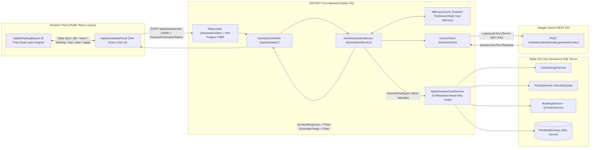
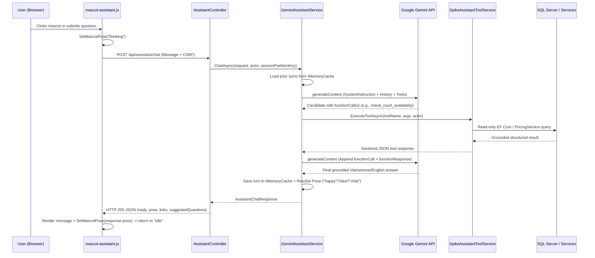

# SPIKE OS — GEMINI AI MASCOT ASSISTANT ARCHITECTURE

## 1. High-Level System Architecture

The **Spike AI Mascot Assistant** transforms the floating 6-pose animated mascot (`#spikeFloatingMascot`) into a live, production-oriented AI concierge backed by **Google Gemini** (`gemini-3.5-flash-lite` primary with automatic fallback to `gemini-3.1-flash-lite`) and authorized, read-only server-side tools querying the live Spike OS database and business services.

---

## 2. Core Components & Responsibilities

| Layer | File | Responsibility |
| :--- | :--- | :--- |
| **Configuration** | `Configuration/GeminiOptions.cs` | Strongly-typed options bound to `"Gemini"` config section and `GEMINI_API_KEY` environment fallback. Validates HTTPS base URL, model identifier, timeouts, token caps, and key presence without logging secrets. |
| **API Controller** | `Controllers/AssistantController.cs` | Exposes `GET /api/assistant/status`, `POST /api/assistant/chat`, and `POST /api/assistant/reset`. Enforces `[ValidateAntiForgeryToken]`, `[EnableRateLimiting("AssistantLimiter")]`, and isolates conversation memory by authenticated `AccountId` or HttpOnly cookie `spike_ai_sid`. |
| **Orchestration & Memory** | `Services/GeminiAssistantService.cs` | Manages multi-turn conversation history (`IMemoryCache`), system instruction assembly with Vietnam time (`UTC+7`), multi-round tool-calling loop (up to 3 rounds), concurrency gating (`SemaphoreSlim`), duplicate in-flight request deduplication, verified route extraction, and semantic mascot pose selection. |
| **Gemini HTTP Client** | `Services/GeminiAssistantService.cs` (`GeminiClient`) | Sends `generateContent` requests to `https://generativelanguage.googleapis.com/v1beta` using `x-goog-api-key` request headers, parses `functionCall` and `text` candidate parts, enforces request timeouts, and performs single-hop automatic failover from `gemini-3.5-flash-lite` to `gemini-3.1-flash-lite` on transient upstream errors (`404`/`408`/`429`/`5xx`). |
| **Read-Only Tool Executor** | `Services/SpikeAssistantToolService.cs` | Executes strictly allowlisted read-only tools (`get_club_info`, `check_court_availability`, `get_pricing_quote`, `search_proshop_products`, `get_website_guide`, `get_my_bookings`) against `PickleballContext`, `ClubSettingsService`, `PricingService`, `BookingService`, and `QrTokenService`. |
| **Frontend UI & Pose Engine** | `wwwroot/js/mascot-assistant.js` & `wwwroot/css/components/mascot-assistant.css` | Renders the floating `#spikeAssistantPanel` above `#spikeFloatingMascot`, handles CSRF token retrieval, conversation rendering, suggested question chips, verified internal route links, retry controls, and dual-layer PNG crossfade pose transitions (`01_idle.png`–`06_jump.png`). |

---

## 3. Multi-Turn Tool-Calling Sequence

---

## 4. Mascot State & Pose Synchronization

The assistant preserves the 6-pose PNG crossfade architecture (`180–240ms` opacity/scale/translate crossfade across two stacked `` layers) and maps conversational events to visual states:

- **`idle` (`01_idle.png`)**: Default resting state when the panel is closed or after a response finishes displaying.
- **`wave` (`02_wave.png`)**: Triggered when opening the chat panel, greeting the user, or resetting the conversation.
- **`thinking` (`03_thinking.png`)**: Active while waiting for `POST /api/assistant/chat` or when displaying a recoverable warning/error state.
- **`chat` (`04_chat.png`)**: Standard conversational reply pose.
- **`idea` (`05_point.png`)**: Triggered when explaining pricing breakdowns (`get_pricing_quote`) or website usage guides (`get_website_guide`).
- **`happy` (`06_jump.png`)**: Triggered when court availability checks (`check_court_availability`) confirm open slots for the customer.
